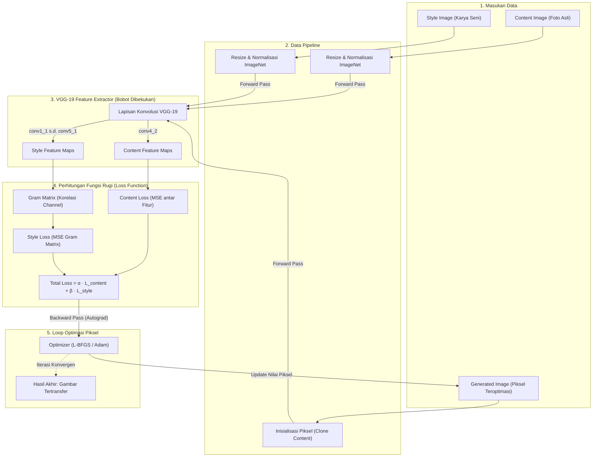

<div align="center">

# Neural Style Transfer (NST)
### *Generative AI From Scratch via Vibe Coding Methodology*

[](https://www.python.org/)
[](https://pytorch.org/)
[]()
[]()
[]()

<p align="center">
  Implementasi algoritma <b>Neural Style Transfer (NST)</b> berbasis fitur konvolusi <b>VGG-19</b>, <b>Content Loss</b>, <b>Style Loss via Gram Matrix</b>, dan <b>Optimasi Piksel</b> dari nol (<i>from scratch</i>) secara modular, tanpa menyalin kode tutorial eksternal.
</p>

[Tentang Proyek](#-tentang-proyek) •
[Hasil NST](#-hasil-nst) •
[Tim Pengembang](#-tim-pengembang) •
[Arsitektur & Algoritma](#-arsitektur--alur-kerja) •
[Struktur Direktori](#-struktur-direktori) •
[Instalasi & Penggunaan](#-panduan-instalasi--eksekusi) •
[Dokumen Master](#-navigasi-dokumen-master) •
[Laporan Akhir](docs/FINAL_REPORT.md)

---

</div>

## 📌 Tentang Proyek

Proyek ini bertujuan mengimplementasikan algoritma **Neural Style Transfer** orisinal yang diperkenalkan oleh *Gatys et al. (2016)*. Berbeda dengan pelatihan model *deep learning* konvensional, proyek ini berpegang pada prinsip teknis utama:

1. **Pembekuan Bobot Model (*Frozen Weights*):** Bobot jaringan saraf tiruan VGG-19 yang telah dilatih (*pretrained on ImageNet*) dibekukan sepenuhnya (`requires_grad = False`) dan hanya digunakan murni sebagai pengekstrak fitur visual (*feature extractor*).
2. **Optimasi terhadap Piksel Gambar:** Variabel yang dioptimasi secara bertahap melalui algoritma optimasi (*gradient descent* / L-BFGS / Adam) adalah nilai piksel dari gambar target (*generated image*), bukan parameter atau bobot model.
3. **Pengembangan Mandiri (*From Scratch*):** Seluruh formulasi matematis—mulai dari ekstraksi representasi konten, kalkulasi korelasi fitur melalui **Gram Matrix**, perumusan *Style Loss*, hingga perulangan optimasi (*optimization loop*)—diimplementasikan secara mandiri tanpa menggunakan pustaka *style transfer* instan.
4. **Metodologi Vibe Coding Berdisiplin:** Mengedepankan kolaborasi terstruktur bersama *Large Language Model* (LLM) dengan pendekatan *Stage-Gate Sequential*, di mana seluruh interaksi, proses *debugging*, hingga justifikasi arsitektur terdokumentasi secara transparan.

📄 Laporan lengkap proyek: **[docs/FINAL_REPORT.md](docs/FINAL_REPORT.md)**

---

## 🎨 Hasil NST

Eksperimen akhir Stage 6 (S06-02 — *Final Showcase*: Menara Eiffel `706×1500` + Lukisan Kaca Patri Abstrak `1280×720`, di-*resize* ke `256×256`, L-BFGS 50 langkah, `lr=0.5`, $\alpha=1.0$, $\beta=10^4$, `init_mode='content'`, CPU):


| Metrik | Nilai |
| :--- | :--- |
| Total loss awal → akhir | `21.0097` → `0.8701` (**−95.86%**), monoton mulus selama 50 langkah |
| Waktu eksekusi | 36.84 detik (CPU) |
| Gambar hasil | [`outputs/images/stylized_output.png`](outputs/images/stylized_output.png) |

> **Catatan:** artefak di atas dihasilkan dengan VGG-19 *fallback offline* (bobot terkalibrasi deterministik `fan_in`) saat eksekusi tanpa koneksi internet. Jalankan `python main.py` dengan koneksi internet untuk memakai bobot pretrained ImageNet sesuai D-001. Rincian lengkap di [FINAL_REPORT.md §4](docs/FINAL_REPORT.md#4-hasil-eksperimen--visualisasi).

---

## 👥 Tim Pengembang

Proyek ini dikerjakan secara kolaboratif oleh tim yang terdiri dari 4 peran dengan pembagian tanggung jawab spesifik:

| Peran | Nama Anggota | NIM | Fokus Tanggung Jawab Utama |
| :--- | :--- | :---: | :--- |
| **A1 — Ketua, Prompt Engineer & Arsitek** | **Samuel Aaron** | `103012580024` | Perancangan arsitektur, tata kelola *prompting*, implementasi ekstraktor VGG-19, dan integrasi sistem akhir. |
| **A2 — Data Pipeline & Preprocessing Engineer** | **Marthin M. Tambunan** | `103012580055` | Penyiapan dataset gambar, *image loader*, augmentasi, *resizing*, normalisasi ImageNet, dan *unit test* data. |
| **A3 — Loss Function & Optimization Engineer** | **Hafiz Fajar Ramadhan** | `103012430027` | Implementasi matematis *Gram Matrix*, formulasi *Content & Style Loss*, serta penyusunan *optimization loop*. |
| **A4 — QA, Dokumentasi & Error Handler** | **Muhammad Rafiq Abdurrasyid** | `103012400240` | Manajemen *logging* interaksi AI, audit kepatuhan kode, *integration testing*, dan penyusunan laporan komprehensif. |

---

## 🧠 Arsitektur & Alur Kerja

Sistem memadukan representasi semantik tingkat tinggi (*Content Representation*) dari layer dalam VGG-19 dengan korelasi tekstur multi-skala (*Style Representation*) yang dihitung melalui *Gram Matrix*.



### Formulasi Matematis

1. **Content Loss ($L_{content}$):**
   Mengukur selisih kuadrat rata-rata (*Mean Squared Error*) antara fitur gambar konten ($P^l$) dan fitur gambar hasil ($F^l$) pada layer $l$:
   $$L_{content}(p, x, l) = \frac{1}{2} \sum_{i, j} \left( F_{ij}^l - P_{ij}^l \right)^2$$

2. **Gram Matrix ($G^l$):**
   Mengekspresikan tekstur gaya seni sebagai korelasi antar-fitur pada dimensi spasial $M = H \times W$:
   $$G_{ij}^l = \sum_k F_{ik}^l F_{jk}^l$$

3. **Style Loss ($L_{style}$):**
   Selisih matriks Gram gambar referensi seni ($A^l$) dan gambar hasil ($G^l$) dengan pembobotan bobot layer $w_l$:
   $$L_{style}(a, x) = \sum_l w_l \frac{1}{4 N_l^2 M_l^2} \sum_{i, j} \left( G_{ij}^l - A_{ij}^l \right)^2$$

4. **Total Loss ($L_{total}$):**
   $$L_{total} = \alpha \cdot L_{content} + \beta \cdot L_{style}$$

---

## 📁 Struktur Direktori

Repositori ini disusun secara modular dengan pemisahan tugas (*separation of concerns*) yang ketat:

```text
neural-style-transfer/
│
├── .vscode/               # Konfigurasi workspace VS Code
│   └── settings.json
│
├── assets/                # Aset gambar masukan
│   ├── content/           # Gambar konten referensi
│   └── style/             # Gambar gaya seni referensi
│
├── config/                # Konfigurasi parameter & hyperparameter
│   └── config.yaml
│
├── docs/                  # Dokumentasi master rekayasa perangkat lunak
│   ├── PRD.md             # Product Requirement Document
│   ├── SRS.md             # Software Requirements Specification
│   ├── ARCHITECTURE.md    # Detail arsitektur teknis & kontrak modul
│   ├── CODING_STANDARDS.md# Standar penulisan kode PEP 8 & type hints
│   ├── AI_RULES.md        # Pedoman wajib kolaborasi bersama AI Agent
│   ├── TASKS.md           # Pembagian tahapan & status tugas anggota
│   ├── TEST_PLAN.md       # Rencana pengujian (Unit & Integration)
│   ├── COMPLEXITY_ANALYSIS.md # Analisis kompleksitas algoritma (Big-O)
│   └── LOG_INTERAKSI.md   # Rekapitulasi interaksi dan keputusan teknis
│
├── logs/                  # Rekam jejak interaksi AI per anggota (Vibe Coding)
│   ├── A1/                # Log percakapan & debugging Anggota 1
│   ├── A2/                # Log percakapan & debugging Anggota 2
│   ├── A3/                # Log percakapan & debugging Anggota 3
│   ├── A4/                # Log percakapan & debugging Anggota 4
│   ├── LOG_TEMPLATE.md    # Template baku pengisian log interaksi
│   └── interactions.jsonl # Metadata log interaksi mesin
│
├── outputs/               # Direktori luaran model
│   ├── graphs/            # Visualisasi grafik penurunan loss
│   └── images/            # Gambar hasil transfer gaya per checkpoint
│
├── scripts/               # Skrip pendukung otomatisasi
│   └── log_interaction.py
│
├── src/                   # Kode sumber utama (modular implementation)
│   ├── __init__.py
│   ├── preprocessing.py   # Modul pipeline & augmentasi gambar (A2)
│   ├── feature_extractor.py # Modul ekstraksi VGG-19 beku (A1)
│   ├── losses.py          # Modul Gram Matrix & formulasi loss (A3)
│   ├── optimization.py    # Modul perulangan optimasi piksel (A3)
│   └── visualization.py   # Modul visualisasi & plotting hasil (A1/A4)
│
├── tests/                 # Unit & integration test otomatis berbasis PyTest
│   ├── test_preprocessing.py
│   ├── test_feature_extractor.py
│   ├── test_losses.py
│   ├── test_optimization.py
│   ├── test_integration.py      # Pipeline end-to-end lintas-modul (A4)
│   ├── test_visualization.py    # Visualisasi & CLI main.py (A1)
│   └── test_log_interaction.py  # Skrip pencatat log AI (A4)
│
├── main.py                # Titik masuk utama eksekusi program (CLI)
├── requirements.txt       # Daftar dependensi pustaka Python
├── .gitignore             # Aturan pengecualian berkas Git
└── README.md              # Dokumentasi utama proyek
```

---

## 🛠️ Panduan Instalasi & Eksekusi

### 1. Prasyarat Lingkungan
* Python 3.11 atau 3.12 (direkomendasikan).
* CUDA Toolkit & GPU NVIDIA (opsional, CPU didukung penuh untuk resolusi moderat).
* Git terpasang di sistem lokal.

### 2. Kloning Repositori & Persiapan Virtual Environment
```powershell
# Kloning repositori
git clone https://github.com/USERNAME/neural-style-transfer.git
cd neural-style-transfer

# Membuat virtual environment
python -m venv .venv

# Mengaktifkan virtual environment (Windows PowerShell)
.venv\Scripts\Activate.ps1

# Mengaktifkan virtual environment (Linux/macOS)
# source .venv/bin/activate
```

### 3. Instalasi Dependensi
```powershell
pip install --upgrade pip
pip install -r requirements.txt
```

### 4. Status Pengujian (*Unit & Integration Tests*)
Sebelum menjalankan proses komputasi utama, pastikan seluruh modul lolos validasi kontrak:
```powershell
pytest tests/ -v -rs
```
Hasil terakhir (Stage 6–7): **90 passed, 2 skipped (CUDA), 60 subtests passed**. Dua test dilewati otomatis bila GPU CUDA tidak tersedia.

| Berkas Test | Hasil |
| :--- | :--- |
| `test_preprocessing.py` | 21 passed, 1 skipped (CUDA) |
| `test_feature_extractor.py` | 8 passed, 1 skipped (CUDA) |
| `test_losses.py` | 20 passed |
| `test_optimization.py` | 9 passed |
| `test_integration.py` | 16 passed |
| `test_visualization.py` | 8 passed |
| `test_log_interaction.py` | 8 passed |

### 5. Cara Menjalankan (*CLI Execution*)
Seluruh nilai default dibaca dari [`config/config.yaml`](config/config.yaml) (D-009). Jalankan dengan konfigurasi default:
```powershell
python main.py
```
Hasil disimpan ke `outputs/images/stylized_output.png`, `outputs/images/comparison_grid.png`, dan `outputs/graphs/loss_curve.png`, lalu ringkasan (loss awal/akhir, penurunan, waktu) dicetak ke terminal.

Setiap nilai dapat di-*override* lewat argumen CLI (`python main.py --help`):

| Opsi | Keterangan | Default (`config.yaml`) |
| :--- | :--- | :--- |
| `--config PATH` | Berkas konfigurasi YAML | `config/config.yaml` |
| `--content PATH` | Gambar konten | `assets/content/content_sample.png` |
| `--style PATH` | Gambar gaya | `assets/style/style_sample.png` |
| `--output-image PATH` | Gambar hasil NST | `outputs/images/stylized_output.png` |
| `--comparison-image PATH` | Panel perbandingan 3-kolom | `outputs/images/comparison_grid.png` |
| `--loss-graph PATH` | Grafik penurunan loss | `outputs/graphs/loss_curve.png` |
| `--size HEIGHT WIDTH` | Ukuran kerja `(H, W)` (D-005) | `256 256` |
| `--steps N` | Jumlah langkah optimasi | `50` |
| `--alpha A` / `--beta B` | Bobot content / style loss | `1.0` / `10000.0` |
| `--optimizer {lbfgs,adam}` | Optimizer piksel | `lbfgs` |
| `--lr LR` | Learning rate | `0.5` |
| `--init-mode {content,style,random}` | Inisialisasi kanvas | `content` |
| `--device {auto,cpu,cuda}` | Perangkat eksekusi | `auto` |
| `--seed SEED` | Seed reprodusibilitas | `42` |
| `--no-pretrained` | Pakai VGG-19 bobot acak terkalibrasi (offline, tanpa unduhan) | nonaktif |

Contoh dengan gambar sendiri dan output terpisah agar artefak resmi tidak tertimpa:
```powershell
python main.py --content assets/content/foto.jpg --style assets/style/lukisan.jpg `
    --output-image outputs/images/hasil_saya.png `
    --comparison-image outputs/images/grid_saya.png `
    --loss-graph outputs/graphs/loss_saya.png --steps 100 --size 512 512
```
*Tanpa koneksi internet, `main.py` otomatis beralih ke VGG-19 offline terkalibrasi bila bobot ImageNet belum ter-cache.*

---

## 📋 Metodologi Kerja & Transparansi Vibe Coding

Proyek ini menerapkan **Stage-Gate Sequential SDLC**, di mana setiap tahapan memiliki *Gatekeeper* dan *Acceptance Criteria* yang wajib dipenuhi sebelum pekerjaan diserahterimakan (*handoff*) ke anggota berikutnya:

| Tahap | Nama Tahapan | Penanggung Jawab | Syarat Kelulusan (*Acceptance Criteria*) |
| :---: | :--- | :---: | :--- |
| **Stage 0** | *Planning & Design* | A1 (Lead) & Tim | Seluruh dokumen master di `docs/` disetujui bersama. |
| **Stage 1** | *Project Scaffolding* | A1 | Struktur folder dan dependensi proyek tervalidasi. |
| **Stage 2** | *Data Pipeline* | A2 | Preprocessing selesai dan lolos `test_preprocessing.py`. |
| **Stage 3** | *Feature Extraction* | A1 | Layer VGG-19 beku tervalidasi bentuk tensornya. |
| **Stage 4** | *Loss & Optimization* | A3 | Gram Matrix & loss teruji numerik, loop optimasi konvergen. |
| **Stage 5** | *QA & Error Handling* | A4 | *Integration test* lulus tanpa regresi, log terdokumentasi. |
| **Stage 6** | *Integration & Evaluation* | A1 & Tim | Eksekusi NST berjalan *end-to-end* menghasilkan luaran valid. |
| **Stage 7** | *Finalization* | Seluruh Tim | Laporan akhir, repositori bersih, dan materi presentasi siap. |

### Prinsip 2-Step Prompting
Setiap anggota berinteraksi dengan AI melalui dua fase terpisah:
1. **Prompt Perancangan (*Planning*):** Meminta analisis algoritma, kontrak fungsi, dan analisis batas memori/waktu tanpa menghasilkan kode implementasi prematur.
2. **Prompt Implementasi (*Implementation*):** Menghasilkan kode hanya setelah rancangan disetujui, dilengkapi *type hints*, *docstrings*, serta *unit testing*.

---

## 📚 Navigasi Dokumen Master

Untuk rincian spesifikasi teknis dan tata kelola proyek yang lebih mendalam, silakan merujuk pada berkas dokumentasi internal:

* 📘 [FINAL_REPORT.md](docs/FINAL_REPORT.md) — **Laporan akhir proyek**: teori, arsitektur, hasil eksperimen, kompleksitas, rekap QA, dan kontribusi anggota.
* 🎤 [DEMO_CHECKLIST.md](docs/DEMO_CHECKLIST.md) — Checklist kesiapan demo, alur presentasi, dan FAQ teknis.
* 📊 [PROGRESS_TRACKER.md](docs/planning/PROGRESS_TRACKER.md) — **Master status pelacakan 23 langkah kerja seluruh anggota tim**.
* 📄 [PRD.md](docs/PRD.md) — *Product Requirement Document* & batasan teknis.
* 📄 [SRS.md](docs/SRS.md) — *Software Requirements Specification* (fungsional & non-fungsional).
* 📐 [ARCHITECTURE.md](docs/ARCHITECTURE.md) — Detail arsitektur, diagram komponen, dan kontrak antarmuka modul.
* 📏 [CODING_STANDARDS.md](docs/CODING_STANDARDS.md) — Standar penulisan Python PEP 8 dan prinsip modularitas.
* 🤖 [AI_RULES.md](docs/AI_RULES.md) — Panduan kepatuhan dan etika kolaborasi AI Agent.
* 📋 [TASKS.md](docs/TASKS.md) — Rincian pembagian tugas dan matriks tahapan pengerjaan.
* 🧪 [TEST_PLAN.md](docs/TEST_PLAN.md) — Protokol pengujian unit, integrasi, dan validasi matematis.
* ⏱️ [COMPLEXITY_ANALYSIS.md](docs/COMPLEXITY_ANALYSIS.md) — Kerangka analisis efisiensi Big-O ruang dan waktu.
* 📝 [LOG_INTERAKSI.md](docs/LOG_INTERAKSI.md) — Indeks resmi seluruh log interaksi AI tim, ringkasan *debugging*, dan rekap keputusan D-001–D-009.
* 🤝 [HANDOFF.md](docs/HANDOFF.md) — Riwayat serah terima antar-stage (Handoff #1–#11).

---

## 📖 Referensi Ilmiah

* Gatys, L. A., Ecker, A. S., & Bethge, M. (2016). *Image Style Transfer Using Convolutional Neural Networks*. In Proceedings of the IEEE Conference on Computer Vision and Pattern Recognition (CVPR), pp. 2414-2423.
* Simonyan, K., & Zisserman, A. (2014). *Very Deep Convolutional Networks for Large-Scale Image Recognition*. arXiv preprint arXiv:1409.1556.

---

<div align="center">
  <sub>Dibangun dengan dedikasi akademis dan integritas rekayasa perangkat lunak.</sub>
</div>
