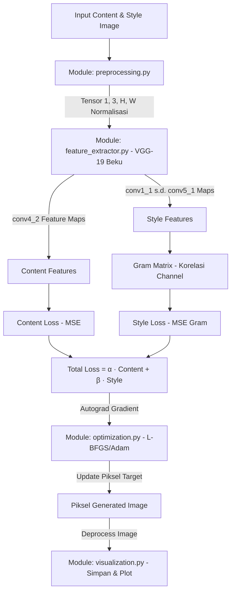

# ARCHITECTURE — Neural Style Transfer (NST)

Dokumen ini mendefinisikan arsitektur sistem, aliran data tensor, dan kontrak antarmuka (*API contracts*) antar-modul untuk proyek Neural Style Transfer berbasis VGG-19 beku.

---

## 1. Alur Kerja Sistem (Mermaid Flowchart)

---

## 2. Kontrak Modul & Spesifikasi Fungsi

### A. Modul Preprocessing (`src/preprocessing.py`) — PIC: A2

> **Kebijakan Tunggal Parameter `size` (Keputusan D-005):**
> 1. Seluruh fungsi pada `src/preprocessing.py` menggunakan nama parameter **`size`** (bukan `target_size`).
> 2. Tuple `size` **selalu didefinisikan sebagai `(height, width)` = `(H, W)`** mengikuti konvensi PyTorch `[N, C, H, W]`.
> 3. Saat memanggil `PIL.Image.resize` secara internal, tuple `(height, width)` wajib dibalik menjadi `(width, height)`: `image.resize((width, height), Image.Resampling.LANCZOS)`.
> 4. Metode resize menggunakan *direct exact resize* ke `(H, W)` dengan filter `Image.Resampling.LANCZOS` (tanpa *cropping*).
> 5. Validasi `size`: Harus `None` atau `tuple[int, int]` berisi tepat 2 integer murni (`not isinstance(v, bool)`) dengan `H > 0` dan `W > 0`. Selain itu wajib melempar `ValueError`.

* **`load_image(image_path: str | Path, size: tuple[int, int] | None = None) -> Image.Image`**
  * *Deskripsi:* Membaca file JPEG/PNG, memvalidasi format isi file, dan mengonversi ke mode `"RGB"` mandiri (file sumber ditutup).
  * *Perilaku Resize:*
    * Jika `size=None`: mengembalikan `PIL.Image` RGB dengan ukuran asli.
    * Jika `size=(H, W)`: memvalidasi `size` dan melakukan resize `LANCZOS` sehingga `result.height == H` dan `result.width == W` (yaitu `result.size == (W, H)`).
  * *Exceptions:* `FileNotFoundError`, `ValueError` (format bukan JPEG/PNG, file tidak dikenali, atau `size` tidak valid), `OSError` (akses file atau decoding gagal pada format yang dikenali, termasuk gambar truncated).
  * *Klarifikasi S02-04:* Pembedaan file tidak dikenali versus kegagalan decode di atas mengikuti implementasi yang sudah ada; bukan perubahan runtime/kontrak atau persetujuan manusia baru.
* **`preprocess_image(image: Image.Image | str | Path, size: tuple[int, int] | None = (512, 512), device: torch.device | str = "cpu") -> torch.Tensor`**
  * *Deskripsi:* Mengubah gambar menjadi Tensor PyTorch 4D `(1, 3, H, W)` bertipe `torch.float32` yang siap dimasukkan ke VGG-19.
  * *Perilaku Alur & Resize (Tanpa Double Resize):*
    * Jika `image` berupa `str | Path`: memanggil `load_image(image, size=size)`.
    * Jika `image` berupa `PIL.Image.Image`: memastikan mode `"RGB"`. Jika `size is not None`, memvalidasi `size` dan hanya melakukan resize `LANCZOS` ke `(H, W)` apabila `(image.height, image.width) != size`. Jika `size is None`, mempertahankan ukuran gambar saat itu.
  * *Normalisasi:* Skala awal piksel `[0.0, 1.0]` dinormalisasi dengan standar ImageNet ($\mu = [0.485, 0.456, 0.406]$, $\sigma = [0.229, 0.224, 0.225]$).
  * *Output Shape:* `(1, 3, H, W)` bertipe `torch.float32` pada `device` yang ditentukan.
  * *Exceptions:* `TypeError` / `ValueError` jika tipe `image` atau nilai `size` tidak valid.
* **`deprocess_image(tensor: torch.Tensor) -> Image.Image`**
  * *Deskripsi:* Mengembalikan tensor hasil olahan menjadi `PIL.Image.Image` mode `"RGB"`.
  * *Operasi:* Menerima tensor 4D `(1, 3, H, W)` atau 3D `(3, H, W)` (selain itu lempar `ValueError`), menyalin secara aman (`detach().cpu().clone()`), menghapus dimensi batch menjadi `(3, H, W)`, denormalisasi ($x \times \sigma + \mu$), *clamping* ke rentang $[0.0, 1.0]$, konversi ke `uint8` `[0, 255]`, dan mengembalikan `PIL.Image` RGB dengan `height == H` dan `width == W`.
  * *Klarifikasi Validasi S02-03:* Input bukan tensor ditolak dengan `TypeError`; dtype non-floating, nilai NaN/Inf, dan dimensi spasial kosong ditolak dengan `ValueError`. Konversi ke `uint8` membulatkan nilai piksel terdekat setelah clamp untuk menghindari bias truncation pada round-trip. Gambar PIL berdimensi kosong pada `preprocess_image` juga ditolak dengan `ValueError`.

### B. Modul Feature Extractor (`src/feature_extractor.py`) — PIC: A1

> **Kebijakan Ekstraksi Fitur VGG-19 Beku (Keputusan D-006):**
> 1. Pemetaan layer standar Gatys et al. (`DEFAULT_LAYERS`):
>    * `'0': 'conv1_1'` (*Style*, $64$ ch, $H \times W$)
>    * `'5': 'conv2_1'` (*Style*, $128$ ch, $\lfloor H/2 \rfloor \times \lfloor W/2 \rfloor$)
>    * `'10': 'conv3_1'` (*Style*, $256$ ch, $\lfloor H/4 \rfloor \times \lfloor W/4 \rfloor$)
>    * `'19': 'conv4_1'` (*Style*, $512$ ch, $\lfloor H/8 \rfloor \times \lfloor W/8 \rfloor$)
>    * `'21': 'conv4_2'` (*Content*, $512$ ch, $\lfloor H/8 \rfloor \times \lfloor W/8 \rfloor$)
>    * `'28': 'conv5_1'` (*Style*, $512$ ch, $\lfloor H/16 \rfloor \times \lfloor W/16 \rfloor$)
> 2. Sekuens `vgg19.features` dipotong hingga indeks `'28'` (`features[:29]`) dan seluruh `nn.ReLU(inplace=True)` diganti menjadi `nn.ReLU(inplace=False)` agar tensor fitur `Conv2d` tidak termodifikasi *in-place* oleh layer ReLU berikutnya serta menjaga keutuhan grafik *autograd*.
> 3. Seluruh parameter model dibekukan (`requires_grad = False`) dan model diset ke `.eval()`.

* **`get_vgg19_model(device: torch.device | str = "cpu", weights: VGG19_Weights | None = VGG19_Weights.DEFAULT) -> torch.nn.Sequential`**
  * *Deskripsi:* Memuat lapisan konvolusi `vgg19(weights=weights).features[:29]`, mengganti `ReLU(inplace=True)` menjadi `ReLU(inplace=False)`, membekukan seluruh parameter (`requires_grad = False`), mengunci mode `.eval()`, dan memindahkan model ke `device`.
  * *Catatan Pengujian:* Default `weights=VGG19_Weights.DEFAULT` memuat bobot ImageNet-1K; pengiriman `weights=None` didukung untuk pengujian struktur dan *autograd* secara cepat/offline.
* **`get_features(image_tensor: torch.Tensor, model: torch.nn.Module, layers: dict[str, str] | None = None) -> dict[str, torch.Tensor]`**
  * *Deskripsi:* Melakukan *forward pass* sekuensial melalui `model` (tanpa `torch.no_grad()` agar gradien tetap mengalir ke `image_tensor` jika `requires_grad=True`) dan mengekstrak dictionary tensor fitur sesuai pemetaan `layers` (default `DEFAULT_LAYERS`).
  * *Validasi & Exceptions:*
    * `TypeError` jika `image_tensor` bukan `torch.Tensor` atau `model` bukan `torch.nn.Module`.
    * `ValueError` jika `image_tensor` bukan 4D `(N, 3, H, W)` dengan `N >= 1`, `C == 3`, `H >= 16`, `W >= 16`, bukan floating-point, mengandung `NaN`/`Inf`, atau jika `layers` kosong / meminta indeks layer yang tidak ada di dalam `model`.

### C. Modul Loss Functions (`src/losses.py`) — PIC: A3
* **`gram_matrix(tensor: torch.Tensor) -> torch.Tensor`**
  * *Deskripsi:* Menghitung korelasi channel $G = F \times F^T$ dinormalisasi dengan $C \times H \times W$. Output shape `(1, C, C)`.
* **`compute_content_loss(gen_features: torch.Tensor, content_features: torch.Tensor) -> torch.Tensor`**
  * *Deskripsi:* MSE antara fitur konten asli dan fitur konten gambar hasil.
* **`compute_style_loss(gen_features_dict: dict, style_gram_dict: dict, layer_weights: dict) -> torch.Tensor`**
  * *Deskripsi:* Penjumlahan berbobot dari selisih MSE Gram Matrix pada multi-layer.
* **`compute_total_loss(content_loss, style_loss, alpha=1.0, beta=1e4) -> torch.Tensor`**
  * *Deskripsi:* $L_{total} = \alpha \cdot L_{content} + \beta \cdot L_{style}$.

### D. Modul Optimasi (`src/optimization.py`) — PIC: A3
* **`run_style_transfer(...) -> tuple[torch.Tensor, list[float]]`**
  * *Deskripsi:* Perulangan optimasi piksel gambar target menggunakan L-BFGS/Adam, clamping tiap iterasi, dan mencatat riwayat penurunan loss.

### E. Modul Visualisasi (`src/visualization.py`) — PIC: A1 / A4
* **`save_image(tensor: torch.Tensor, output_path: str | Path) -> None`**
* **`plot_loss_history(loss_history: list[float], output_path: str | Path) -> None`**

---

## 3. Ketentuan Dimensi & Tipe Tensor Global

1. **Format Tensor & Ukuran:** Seluruh tensor gambar dalam pipeline wajib berbentuk 4D: `(N, C, H, W)` di mana $N=1$ (batch size), $C=3$ (RGB), $H$ = tinggi (*height*), $W$ = lebar (*width*). Seluruh parameter `size` menggunakan urutan `(H, W)`.
2. **Tipe Data:** `torch.float32`.
3. **Reproducibility:** Seluruh random initialization wajib dikunci dengan random seed di `config/config.yaml`.
4. **Pemisahan Modul:** Setiap modul hanya berinteraksi melalui fungsi antarmuka resmi di atas tanpa mengakses variabel internal modul lain.
