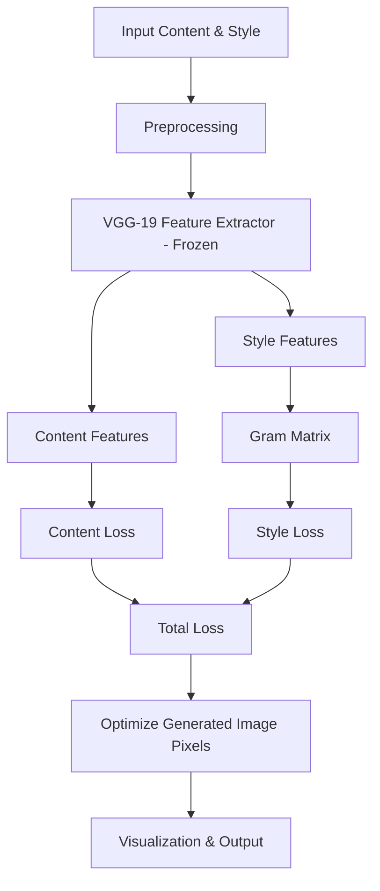

# ARCHITECTURE - Neural Style Transfer

## Alur Umum (Mermaid)

## Modul & Kontrak (Stage 0/1 - kontrak saja)
- preprocessing.py: load_image, preprocess, postprocess (placeholder)
- feature_extractor.py: get_features, get_vgg_model (frozen)
- losses.py: gram_matrix, content_loss, style_loss, total_loss
- optimization.py: run_optimization
- visualization.py: show/save

Semua tensor: [batch, channel, h, w] - normalisasi sesuai VGG
