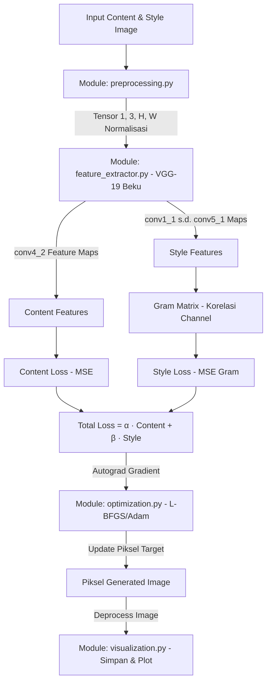

# ARCHITECTURE — Neural Style Transfer (NST)

Dokumen ini mendefinisikan arsitektur sistem, aliran data tensor, dan kontrak antarmuka (*API contracts*) antar-modul untuk proyek Neural Style Transfer berbasis VGG-19 beku.

---

## 1. Alur Kerja Sistem (Mermaid Flowchart)

---

## 2. Kontrak Modul & Spesifikasi Fungsi

### A. Modul Preprocessing (`src/preprocessing.py`) — PIC: A2
* **`load_image(image_path: str | Path, size: tuple[int, int] | None = None) -> Image.Image`**
  * *Deskripsi:* Membaca file JPEG/PNG, memvalidasi format, mengonversi ke RGB mandiri. Jika `size` diberikan, melakukan resize kualitas tinggi (`LANCZOS`).
  * *Exceptions:* `FileNotFoundError`, `ValueError` (format salah/rusak).
* **`preprocess_image(image: Image.Image | str | Path, target_size: tuple[int, int] = (512, 512), device: torch.device | str = "cpu") -> torch.Tensor`**
  * *Deskripsi:* Mengubah gambar menjadi Tensor PyTorch 4D `(1, 3, H, W)` bertipe `torch.float32`.
  * *Normalisasi:* ImageNet standar ($\mu = [0.485, 0.456, 0.406]$, $\sigma = [0.229, 0.224, 0.225]$).
  * *Output Shape:* `(1, 3, target_size[0], target_size[1])` pada `device` yang ditentukan.
* **`deprocess_image(tensor: torch.Tensor) -> Image.Image`**
  * *Deskripsi:* Mengembalikan tensor hasil olahan menjadi `PIL.Image.Image` (RGB).
  * *Operasi:* Hapus dimensi batch `(3, H, W)`, denormalisasi ($x \times \sigma + \mu$), *clamping* ke rentang $[0.0, 1.0]$, konversi ke uint8 `[0, 255]`.

### B. Modul Feature Extractor (`src/feature_extractor.py`) — PIC: A1
* **`get_vgg19_model(device: torch.device | str = "cpu") -> torch.nn.Module`**
  * *Deskripsi:* Memuat lapisan konvolusi `vgg19(weights=VGG19_Weights.DEFAULT).features` dan membekukan seluruh parameter (`requires_grad = False`).
* **`get_features(image_tensor: torch.Tensor, model: torch.nn.Module, layers: dict = None) -> dict[str, torch.Tensor]`**
  * *Deskripsi:* Melakukan forward pass dan mengekstrak tensor representasi konten (`conv4_2`) dan gaya (`conv1_1`, `conv2_1`, `conv3_1`, `conv4_1`, `conv5_1`).

### C. Modul Loss Functions (`src/losses.py`) — PIC: A3
* **`gram_matrix(tensor: torch.Tensor) -> torch.Tensor`**
  * *Deskripsi:* Menghitung korelasi channel $G = F \times F^T$ dinormalisasi dengan $C \times H \times W$. Output shape `(1, C, C)`.
* **`compute_content_loss(gen_features: torch.Tensor, content_features: torch.Tensor) -> torch.Tensor`**
  * *Deskripsi:* MSE antara fitur konten asli dan fitur konten gambar hasil.
* **`compute_style_loss(gen_features_dict: dict, style_gram_dict: dict, layer_weights: dict) -> torch.Tensor`**
  * *Deskripsi:* Penjumlahan berbobot dari selisih MSE Gram Matrix pada multi-layer.
* **`compute_total_loss(content_loss, style_loss, alpha=1.0, beta=1e4) -> torch.Tensor`**
  * *Deskripsi:* $L_{total} = \alpha \cdot L_{content} + \beta \cdot L_{style}$.

### D. Modul Optimasi (`src/optimization.py`) — PIC: A3
* **`run_style_transfer(...) -> tuple[torch.Tensor, list[float]]`**
  * *Deskripsi:* Perulangan optimasi piksel gambar target menggunakan L-BFGS/Adam, clamping tiap iterasi, dan mencatat riwayat penurunan loss.

### E. Modul Visualisasi (`src/visualization.py`) — PIC: A1 / A4
* **`save_image(tensor: torch.Tensor, output_path: str | Path) -> None`**
* **`plot_loss_history(loss_history: list[float], output_path: str | Path) -> None`**

---

## 3. Ketentuan Dimensi & Tipe Tensor Global

1. **Format Tensor:** Seluruh tensor gambar dalam pipeline wajib berbentuk 4D: `(N, C, H, W)` di mana $N=1$ (batch size), $C=3$ (RGB).
2. **Tipe Data:** `torch.float32`.
3. **Reproducibility:** Seluruh random initialization wajib dikunci dengan random seed di `config/config.yaml`.
4. **Pemisahan Modul:** Setiap modul hanya berinteraksi melalui fungsi antarmuka resmi di atas tanpa mengakses variabel internal modul lain.
