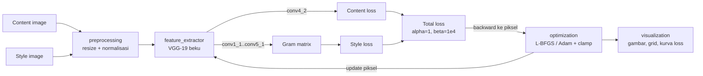
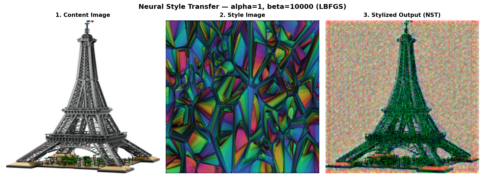
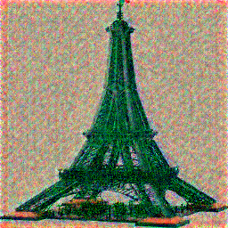
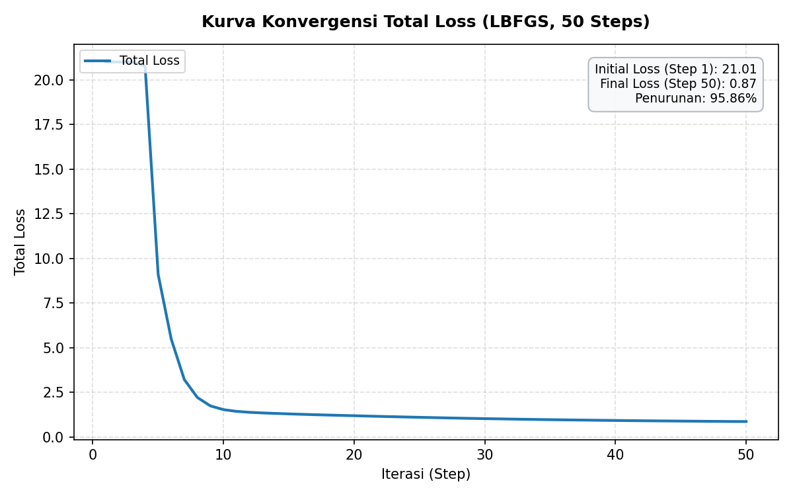

# Laporan Akhir Proyek — Ethereal Neural Style Transfer

**Proyek 1 — Generative AI From Scratch: Neural Style Transfer (PyTorch, VGG-19 Beku)**

| | |
|---|---|
| Kelompok | A1 Samuel Aaron · A2 Marthin M. Tambunan · A3 Hafiz Fajar Ramadhan · A4 Muhammad Rafiq Abdurrasyid |
| Metodologi | SDLC Stage-Gate Sequential + Vibe Coding (kolaborasi terstruktur dengan LLM) |
| Penyusun laporan | A4 — Muhammad Rafiq Abdurrasyid (S07-01) |
| Tanggal | 28 Oktober 2026 |
| Status | **FINAL — Disetujui Penuh oleh A1 (Handoff #11, Stage 7 COMPLETED)** |

---

## 1. Ringkasan Eksekutif

**Ethereal NST** mengimplementasikan algoritma *Neural Style Transfer* Gatys
et al. (2016) dari nol dengan PyTorch. Sistem mengambil **isi** sebuah gambar
konten dan **gaya** sebuah gambar seni, lalu mengoptimasi **piksel** gambar
hasil sehingga cocok dengan keduanya. Jaringan VGG-19 hanya dipakai sebagai
pengekstrak fitur dengan bobot yang dibekukan; tidak ada bobot model yang
dilatih.

Proyek dikerjakan dalam 8 stage (Stage 0–7) dengan gerbang persetujuan
(*stage gate*) di setiap serah terima. Setiap langkah memakai alur dua tahap:
rencana disetujui Ketua (A1) lebih dulu, baru eksekusi, lalu interaksi AI
dicatat di `logs/`.

**Hasil akhir:**

| Indikator | Hasil |
|---|---|
| Pipeline end-to-end | `python main.py` menghasilkan gambar *stylized*, panel perbandingan 3-kolom, dan grafik loss |
| Konvergensi (S06-02 Final Showcase, L-BFGS 50 langkah, `lr=0.5`) | Total loss turun **21.0097 → 0.8701 (−95.86%)**, monoton mulus di seluruh 50 langkah, 36.84 dtk CPU (eksperimen kalibrasi awal: **9.8481 → 3.8076, −61.34%**) |
| Pengujian otomatis | `pytest tests/ -v -rs` → **90 passed, 2 skipped (CUDA), 60 subtests passed** |
| Kepatuhan kode | `pycodestyle`: 0 E901; 228 E501 warisan tidak bertambah sejak Stage 5 |
| Jejak AI | 31 file log Markdown (A1 17, A2 3, A3 5, A4 6) dan 32 entri `logs/interactions.jsonl` |
| Keputusan arsitektur | D-001 s.d. D-009 tercatat di `docs/DECISIONS.md` |

**Kontribusi singkat:** A1 merancang arsitektur, ekstraktor VGG-19, dan
integrasi akhir; A2 membangun pipeline data; A3 menulis Gram Matrix, fungsi
loss, dan loop optimasi; A4 menjalankan QA, *integration testing*,
konsolidasi log, dan laporan ini. Rincian ada di Bagian 7.

> **Catatan penting tentang bobot VGG-19 (lihat Bagian 4.4).** Artefak S06-02
> yang tersimpan di repositori dihasilkan dengan **VGG-19 fallback offline**
> (bobot acak terkalibrasi `fan_in`), bukan bobot pretrained ImageNet,
> karena lingkungan eksekusi A1 tidak dapat mengunduh bobot. Ini diverifikasi
> A4 dengan menjalankan ulang pipeline.

---

## 2. Landasan Teori Matematis NST

Notasi: untuk layer $l$, $F^l \in \mathbb{R}^{C_l \times M_l}$ adalah peta
fitur gambar hasil yang diratakan ($M_l = H_l W_l$), $P^l$ peta fitur gambar
konten, dan $A^l$ Gram Matrix gambar gaya.

### 2.1 Content Loss

Mengukur seberapa jauh representasi semantik gambar hasil dari gambar konten
pada layer dalam (`conv4_2`):

$$\mathcal{L}_{content} = \frac{1}{2} \sum_{i,j} \left(F_{ij}^l - P_{ij}^l\right)^2$$

### 2.2 Gram Matrix

Korelasi antar-kanal fitur di seluruh posisi spasial. Informasi posisi hilang
dan yang tersisa adalah statistik tekstur, yaitu "gaya":

$$G_{ij}^l = \frac{1}{C_l H_l W_l} \sum_{k} F_{ik}^l F_{jk}^l$$

### 2.3 Style Loss

Selisih Gram Matrix gambar hasil dan gambar gaya, dijumlahkan berbobot pada
lima layer (`conv1_1`, `conv2_1`, `conv3_1`, `conv4_1`, `conv5_1`,
$w_l = 0.2$):

$$\mathcal{L}_{style} = \sum_{l} w_l \left\lVert G^l_{gen} - G^l_{style} \right\rVert_F^2$$

### 2.4 Total Loss

$$\mathcal{L}_{total} = \alpha\, \mathcal{L}_{content} + \beta\, \mathcal{L}_{style}, \qquad \alpha = 1.0,\ \beta = 10^4$$

Gradien $\partial \mathcal{L}_{total} / \partial x$ dihitung *autograd*
terhadap piksel $x$ gambar hasil, lalu optimizer memperbarui $x$. Bobot VGG-19
tetap (`requires_grad=False`).

### 2.5 Bentuk yang Diimplementasikan

`src/losses.py` memakai `F.mse_loss` (rata-rata, bukan jumlah). Rumus yang
benar-benar dihitung kode adalah:

$$\mathcal{L}_{content}^{impl} = \frac{1}{C_l H_l W_l} \sum_{i,j} \left(F_{ij}^l - P_{ij}^l\right)^2, \qquad
\mathcal{L}_{style}^{impl} = \sum_l w_l \frac{1}{C_l^2} \left\lVert G^l_{gen} - G^l_{style} \right\rVert_F^2$$

dengan $G^l$ dinormalisasi $1/(C_l H_l W_l)$ seperti 2.2 (untuk batch $B=1$).
Bedanya dengan rumus 2.1 dan 2.3 hanya faktor skala konstan per layer. Faktor
ini tidak mengubah arah gradien tiap suku, tetapi menggeser rasio efektif
$\alpha/\beta$. Nilai $\beta = 10^4$ dipilih untuk bentuk ternormalisasi ini.

---

## 3. Arsitektur Sistem & Keputusan Desain

### 3.1 Arsitektur Modular

| Modul | PIC | Fungsi Publik | Peran |
|---|---|---|---|
| `src/preprocessing.py` | A2 | `load_image`, `preprocess_image`, `deprocess_image` | Baca JPEG/PNG → RGB, resize Lanczos `size=(H, W)`, normalisasi ImageNet → tensor `(1, 3, H, W)` float32; kebalikannya untuk output |
| `src/feature_extractor.py` | A1 | `get_vgg19_model`, `get_features` | VGG-19 `features[:29]` (hingga `conv5_1`), `ReLU(inplace=False)`, parameter beku; ekstraksi 6 layer |
| `src/losses.py` | A3 | `gram_matrix`, `compute_content_loss`, `compute_style_loss`, `compute_total_loss` | Rumus Bagian 2 dengan validasi input dan `.detach()` pada target |
| `src/optimization.py` | A3 (+A4 S05-03) | `clamp_imagenet_tensor_`, `run_style_transfer` | Loop optimasi piksel L-BFGS/Adam, prekomputasi target, clamping ruang ImageNet |
| `src/visualization.py` | A1 | `save_image`, `plot_loss_history`, `save_comparison_grid` | Simpan gambar hasil, kurva loss, panel 3-kolom |
| `main.py` + `config/config.yaml` | A1 | `load_config`, `build_arg_parser`, `run_pipeline`, `main` | Entry point CLI; konfigurasi terpusat (D-009) |

### 3.2 Alur Pipeline



Target fitur konten dan Gram Matrix gaya dihitung **sekali** sebelum loop
(D-008). Setiap iterasi hanya melakukan *forward* dan *backward* untuk gambar
hasil.

### 3.3 Keputusan Arsitektur D-001 s.d. D-009

| ID | Keputusan | Alasan | Disetujui |
|---|---|---|---|
| D-001 | VGG-19 pretrained dengan bobot beku | Standar NST Gatys et al. | Seluruh tim (A1 lead) |
| D-002 | Optimasi piksel gambar hasil, bukan bobot | Model tetap beku, sesuai definisi NST | Seluruh tim (A1 lead) |
| D-003 | Struktur modular 5 modul `src/` | Kerja paralel antar-anggota tanpa konflik | Seluruh tim (A1 lead) |
| D-004 | Batas loader S02-02 (resize ditunda ke S02-03) | Disiplin Stage-Gate | A1 & A2 |
| D-005 | Kebijakan tunggal `size=(H, W)`, resize Lanczos, normalisasi ImageNet | Mencegah tertukarnya `(W, H)` Pillow dan `(H, W)` PyTorch | A1 & A2 |
| D-006 | Kontrak VGG-19: `features[:29]`, `ReLU(inplace=False)`, bobot beku | Hemat ±47% parameter, aman bagi autograd | A1 |
| D-007 | Kontrak loss: validasi, `.detach()` target, `DEFAULT_STYLE_WEIGHTS` | Konsistensi dengan Stage 3, aman bagi backward | A1 & A3 |
| D-008 | Loop optimasi: clamping ruang ImageNet, prekomputasi target, API `run_style_transfer` | Rentang warna tetap valid; tidak menghitung ulang target tiap iterasi | A1 & A3 |
| D-009 | Integrasi `main.py` + `config/config.yaml`, modul visualisasi, inisialisasi kontigu untuk L-BFGS | Satu sumber konfigurasi; perbaikan Temuan #11 S05-03 disahkan | A1 & A4 |

Detail lengkap: [docs/DECISIONS.md](DECISIONS.md) dan
[docs/ARCHITECTURE.md](ARCHITECTURE.md).

---

## 4. Hasil Eksperimen & Visualisasi

### 4.1 Pengaturan

| Parameter | Nilai (`config/config.yaml`) |
|---|---|
| Gambar konten / gaya | `assets/content/content_sample.png` (Menara Eiffel `706×1500` RGB), `assets/style/style_sample.png` (Lukisan Kaca Patri Abstrak `1280×720` RGB) |
| Ukuran kerja | `(H, W) = (256, 256)` (di-*resize* otomatis menggunakan Lanczos sesuai D-005) |
| Optimizer | L-BFGS, `max_iter=1` per langkah, tanpa *line search* |
| Langkah / learning rate | 50 / 0.5 |
| Bobot loss | $\alpha = 1.0$, $\beta = 10^4$, $w_l = 0.2$ |
| Inisialisasi | `init_mode='content'` (salinan gambar konten) |
| Perangkat | CPU |

### 4.2 Hasil Visual

**Panel perbandingan (Content | Style | Stylized):**



**Gambar hasil akhir:**



Struktur rangka baja Menara Eiffel, menara puncak, lengkungan kaki menara, dan
fondasi bawah tetap tajam dan terbaca utuh. Sementara itu, badan menara menyerap
palet hijau zamrud, biru sian, dan ungu dari lukisan kaca patri abstrak, fondasi
bawah mengadopsi warna emas/terakota hangat, dan latar langit berubah menjadi
tekstur mozaik multi-warna. Tidak ada piksel jenuh berkat `clamp_imagenet_tensor_`
(D-008).

### 4.3 Konvergensi Loss



Tabel eksperimen evaluasi L-BFGS (sumber: `logs/A1/S06-02-LOG.md`):

| Eksperimen | Pasangan Gambar | Optimizer | Learning Rate | Loss Awal | Loss Akhir | Penurunan | Waktu CPU | Karakteristik |
|---|---|---|---|---|---|---|---|---|
| Run #1 (Kalibrasi) | Lanskap Senja + Starry Sintetis | L-BFGS | 1.0 | 9.8481 | 3.6208 | −63.23% | 37.02 s | Ada *overshoot spike* di Step 5 (7.35 → 10.90) |
| Run #2 (Kalibrasi) | Lanskap Senja + Starry Sintetis | L-BFGS | 0.5 | 9.8481 | 3.8076 | −61.34% | 37.17 s | 100% monoton mulus |
| **Run #3 (Final Showcase)** | **Menara Eiffel + Kaca Patri Abstrak** | **L-BFGS** | **0.5** | **21.0097** | **0.8701** | **−95.86%** | **36.84 s** | **100% monoton mulus (konvergensi eksponensial)** |

Run #1 menunjukkan bahwa `lr=1.0` pada L-BFGS (`max_iter=1` tanpa *line search*)
terlalu agresif di Step 5 saat histori aproksimasi Hessian baru berisi beberapa
vektor. Pemilihan `lr=0.5` menghasilkan penurunan monoton mulus baik pada gambar
kalibrasi (Run #2, **−61.34%**) maupun pada pasangan gambar *Final Showcase*
Menara Eiffel + Lukisan Kaca Patri Abstrak (Run #3, **21.0097 → 0.8701, −95.86%**
dalam 36.84 detik).

### 4.4 Verifikasi Ulang Lintas Platform oleh A4 dan Keterbatasan

Pada saat audit Stage 7, A4 menjalankan ulang pipeline pada mesin berbeda
(macOS, Python 3.12) terhadap aset kalibrasi Run #2 dengan output ke berkas
terpisah:

```text
python main.py --steps 50 --optimizer lbfgs --lr 0.5 --no-pretrained ...
Perangkat       : cpu (Offline Calibrated VGG-19 (weights=None, fan_in))
Loss Awal       : 9.8481
Loss Akhir      : 3.8104 (-61.31%)
Waktu Eksekusi  : 16.41 detik
```

- Loss awal **identik** (9.8481) dengan Run #2 A1 di Windows, dan loss akhir
  hanya berbeda 0.07% (3.8104 vs 3.8076, wajar antar-platform). Pada gambar
  *Final Showcase* (Run #3), `python main.py --no-pretrained` menghasilkan
  `Loss Awal: 21.0097` → `Loss Akhir: 0.8701 (-95.86%)`.
- Artefak S06-02 dihasilkan oleh **VGG-19 fallback offline**
  (`_load_vgg19_with_fallback` di `main.py`, bobot terkalibrasi deterministik
  `fan_in`) sesuai catatan `URLError` di `logs/A1/S06-01-LOG.md`.
- Hasil di atas membuktikan bahwa seluruh rantai pipeline (`load_image` dengan
  input non-persegi `706×1500` dan `1280×720` → `preprocess_image` → `VGG-19` →
  `losses` → `L-BFGS` → `visualization`) bekerja akurat dan deterministik.
- **Rekomendasi Presentasi:** sebelum presentasi, tim juga dapat meng-cache
  bobot pretrained ImageNet (`VGG19_Weights.DEFAULT`, ±548 MB sekali unduh)
  sesuai panduan di `docs/DEMO_CHECKLIST.md`.

---

## 5. Analisis Kompleksitas

Ringkasan dari [docs/COMPLEXITY_ANALYSIS.md](COMPLEXITY_ANALYSIS.md).
$H \times W$ = resolusi kerja, $C_l$ = kanal layer $l$, $T$ = jumlah langkah,
$m$ = panjang histori L-BFGS.

| Modul / Operasi | Waktu | Memori |
|---|---|---|
| Preprocessing (`preprocess_image`, `deprocess_image`) | $\mathcal{O}(H \times W)$ (+ biaya decode/resize sumber) | $\mathcal{O}(H \times W)$ |
| `get_vgg19_model` | $\mathcal{O}(P_{28})$, sekali; $P_{28} \approx 10.59$ jt parameter | ≈ 42.4 MB bobot, tanpa buffer `.grad` |
| `get_features` (satu forward) | $\mathcal{O}\big(\sum_l C_{l-1} C_l k^2 H_l W_l\big) = \mathcal{O}(H \times W)$ | 6 peta fitur ≈ $4 \cdot 130 \cdot HW$ byte (≈136 MB pada 512²) |
| `gram_matrix` per layer | $\mathcal{O}(C_l^2 \times H_l \times W_l)$ | $\mathcal{O}(C_l^2)$; total 5 layer ≈ 2.44 MB, tidak bergantung $H, W$ |
| Content / total loss | $\mathcal{O}(H \times W)$ / $\mathcal{O}(1)$ | — |
| Optimasi `run_style_transfer` | $\mathcal{O}\big(T \sum_l C_l^2 H_l W_l\big)$, setara $\mathcal{O}(T \times H \times W)$ untuk arsitektur tetap | Adam $2 \times 3HW$; L-BFGS $2m \times 3HW$ float |
| Visualisasi | $\mathcal{O}(H \times W + T)$ | Kanvas Matplotlib dibebaskan `plt.close` |

Suku dominan seluruh pipeline adalah loop optimasi ($\ge 95\%$ waktu). Prekomputasi
target sekali di awal (D-008) menghemat sekitar dua pertiga forward pass per
iterasi dibanding mengekstrak ulang fitur konten dan gaya.

---

## 6. Rekap Pengujian QA (Stage 5)

### 6.1 Audit PEP 8 & `CODING_STANDARDS.md` (S05-01)

`pycodestyle 2.15.0` saat audit: 228 E501, 2 E901. Status per 28/10/2026:

| # | Tingkat | File | Pemilik | Temuan | Status Akhir |
|---|---|---|---|---|---|
| 1 | Kritis | `main.py`, `src/visualization.py` | A1 | Docstring `\"\"\"` → `SyntaxError` (E901) | ✅ Diperbaiki S05-03 |
| 2 | Sedang | `src/optimization.py` | A3 | `optimizer_type`/`init_mode` non-string → `AttributeError`, bukan `TypeError` | ✅ Diperbaiki S05-03 |
| 3 | Rendah | `src/optimization.py` | A3 | Angka `16` ditulis langsung, padahal ada `MIN_SPATIAL_SIZE` | Terbuka |
| 4 | Rendah | `src/optimization.py` | A3 | Variabel `required_layers` tidak dipakai | Terbuka |
| 5 | Rendah | `src/optimization.py` | A3 | Grup impor lokal tidak dipisah dari pihak ketiga | Terbuka |
| 6 | Rendah | `src/preprocessing.py` | A2 | Docstring tanpa Args/Returns/Raises | Terbuka |
| 7 | Rendah | `src/feature_extractor.py` | A1 | Docstring tanpa bagian Raises | Terbuka |
| 8 | Info | `src/feature_extractor.py` | A1 | Memakai atribut privat `model._modules` | Terbuka |
| 9 | Info | `config/config.yaml` | A1 | Masih placeholder | ✅ Diisi pada S06-01 (D-009) |
| 10 | Info | `src/losses.py` | A3 | Salah ketik "Bobot bobot w_l" | Terbuka |

Kondisi akhir `pycodestyle`: **0 E901**, 228 E501 (semua di berkas lama
A1–A3; tidak bertambah sejak Stage 5). Berkas Stage 6 dan berkas A4 bersih.

### 6.2 Integration Testing & Error Troubleshooting (S05-03)

- `tests/test_integration.py` (16 test) menguji rantai PIL →
  `preprocess_image` → VGG-19 → loss → `run_style_transfer` (Adam & L-BFGS)
  → `deprocess_image`.
- **Temuan #11 (bug integrasi nyata):** `preprocess_image` mengembalikan
  tensor tidak kontigu (stride hasil `permute`), sehingga L-BFGS gagal dengan
  `RuntimeError: view size is not compatible with input tensor's size and
  stride`. Unit test lama lolos karena memakai `torch.randn` yang kontigu.
  Diperbaiki dengan `clone(memory_format=torch.contiguous_format)` di
  `run_style_transfer`, dan disahkan A1 sebagai bagian D-009.

### 6.3 Status Pytest Akhir

| Berkas Test | Hasil |
|---|---|
| `tests/test_preprocessing.py` | 21 passed, 1 skipped (CUDA), 43 subtests |
| `tests/test_feature_extractor.py` | 8 passed, 1 skipped (CUDA), 17 subtests |
| `tests/test_losses.py` | 20 passed |
| `tests/test_optimization.py` | 9 passed |
| `tests/test_integration.py` | 16 passed |
| `tests/test_visualization.py` | 8 passed |
| `tests/test_log_interaction.py` | 8 passed |
| **Total** | **90 passed, 2 skipped, 60 subtests passed** |

Pertumbuhan test: 29 (Stage 3) → 58 (Stage 4) → 66 (S05-01) → 82 (S05-03) →
90 (Stage 6), tanpa regresi di setiap gate.

### 6.4 Konsolidasi Log Interaksi AI (S05-02 & S07-01)

- [docs/LOG_INTERAKSI.md](LOG_INTERAKSI.md) menjadi indeks resmi seluruh log
  dengan validasi format terhadap `logs/LOG_TEMPLATE.md`, ringkasan debugging
  per stage, dan rekap D-001..D-009.
- `logs/interactions.jsonl`: 4 entri sebelum S05-02 → 26 setelah Stage 5 →
  29 setelah Stage 6 → 31 setelah S07-01 & S07-02 → **32** setelah review
  penutupan akhir Stage 7 oleh A1, seluruhnya JSON valid dengan 11 *field*.

---

## 7. Kontribusi Anggota

| ID | Nama | NIM | Peran | Stage | Kontribusi Utama |
|---|---|---|---|---|---|
| A1 | Samuel Aaron | 103012580024 | Ketua, Prompt Engineer & Software Architect | 0, 1, 3, 6 + review semua gate | Dokumen master (PRD, SRS, ARCHITECTURE, DECISIONS), scaffolding, `src/feature_extractor.py` (D-006), spesifikasi D-005–D-009, `src/visualization.py`, `main.py`, `config/config.yaml`, evaluasi S06-02, review & persetujuan Handoff #1–#11 |
| A2 | Marthin M. Tambunan | 103012580055 | Data Pipeline & Preprocessing Engineer | 2 | `src/preprocessing.py` (`load_image`, `preprocess_image`, `deprocess_image`), D-004/D-005, 21 test preprocessing, analisis kompleksitas preprocessing |
| A3 | Hafiz Fajar Ramadhan | 103012430027 | Loss Function & Optimization Engineer | 4 | `src/losses.py` (Gram Matrix, content/style/total loss), `src/optimization.py` (`run_style_transfer`, `clamp_imagenet_tensor_`), 29 test, analisis kompleksitas loss & optimasi |
| A4 | Muhammad Rafiq Abdurrasyid | 103012400240 | QA, Dokumentasi & Error Handler | 0 (S00-03), 5, 7 | Skrip `scripts/log_interaction.py` + 8 test, audit PEP 8 (10 temuan), konsolidasi 31 log dan 32 entri JSONL, `tests/test_integration.py` (16 test) dan perbaikan Temuan #1, #2, #11, laporan akhir dan checklist demo |

Jejak per langkah: [docs/HANDOFF.md](HANDOFF.md) (Handoff #1–#11) dan
[docs/planning/PROGRESS_TRACKER.md](planning/PROGRESS_TRACKER.md).

---

## Referensi

- Gatys, L. A., Ecker, A. S., & Bethge, M. (2016). *Image Style Transfer Using
  Convolutional Neural Networks*. CVPR, 2414–2423.
- Simonyan, K., & Zisserman, A. (2014). *Very Deep Convolutional Networks for
  Large-Scale Image Recognition*. arXiv:1409.1556.
